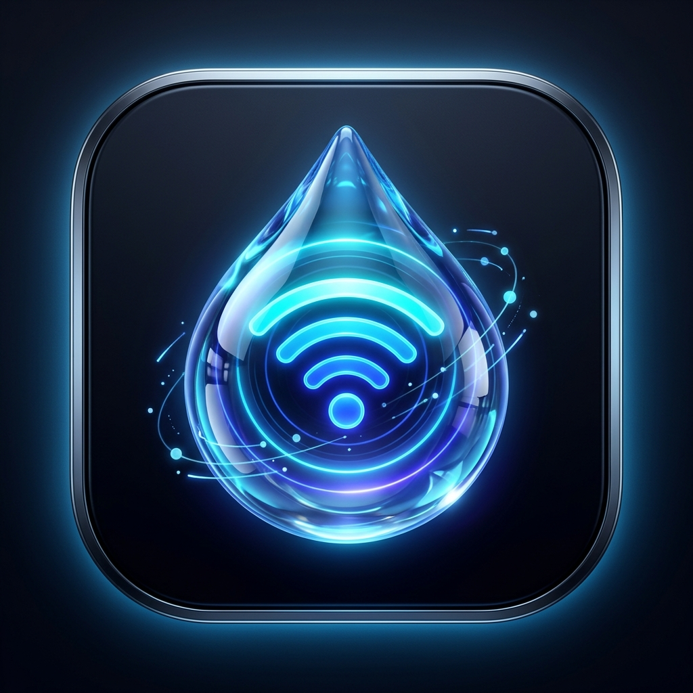

# 💧 AirBeam — Fast & Lossless Local Wi-Fi File Sharing

  

  <b>Blazing-fast lossless local Wi-Fi file sharing across Android and Windows with QR Code multi-device receive.</b>

  
  
  
  

---

## ⚡ What is AirBeam?

**AirBeam** is a modern, high-speed peer-to-peer file sharing application created by **Ranit Saha**. It allows you to beam any file — photos, videos, audio, documents, ZIP archives, or APKs up to **1 GB** — between mobile phones, tablets, and Windows PCs over your local Wi-Fi or mobile hotspot with **zero internet data consumption** and **100% original, bit-for-bit lossless quality**.

---

## ✨ Key Features

- 💎 **100% Bit-for-Bit Lossless Quality**: Zero compression, zero re-encoding. Images, videos, and master audio retain their exact byte structure and metadata.
- 📦 **Up to 1 GB Per Transfer**: Optimized streaming pipeline smoothly handles large files up to 1 GB without memory spikes.
- 📶 **Zero Internet Data Used**: Operates strictly within your local Wi-Fi or phone hotspot at the maximum physical speed of your local router (up to 300+ Mbps).
- 📷 **Instant QR Code Sharing**: The sender generates a dynamic QR code. Receivers scan with AirBeam or their phone camera to download immediately.
- 👥 **Multi-Device Simultaneous Receive**: Multiple devices can scan the **same QR code at the same time** and download the file in parallel!
- 🌐 **Universal Browser Fallback**: Devices without the AirBeam app installed (e.g., iPhone, Mac, Linux, Smart TV) can simply open the QR link in Chrome or Safari to download.
- 🎨 **Unified Design System**: Identical 3D refractive glass droplet branding, animated splash screens, and dark obsidian-cyan UI across Android and Windows.

---

## 🚀 Quick Start Guide

### 📤 Sending a File
1. Make sure your devices are connected to the **same Wi-Fi** or **Mobile Hotspot**.
2. Open **AirBeam** and tap **"Send Files"**.
3. Choose any file up to **1 GB**.
4. A dynamic QR code and local web link (`http://<ip>:8090`) will be displayed.

### 📥 Receiving a File
- **Method 1 (AirBeam App)**: Open AirBeam, tap **"Receive Files"**, enter the sender's address, and tap **"Start Download ⚡"**.
- **Method 2 (Any Camera / Browser)**: Scan the QR code using your regular phone camera or browser (Google Chrome / Safari) and tap the **"Download File ⚡"** button!

---

## 📥 Downloads

| Platform | Format | Description |
| :--- | :--- | :--- |
| **Android** | `.apk` | Universal release APK for Android 8.0+ devices. |
| **Windows Setup** | `.exe` | Full Windows installer with Start Menu & Desktop shortcuts. |
| **Windows Portable** | `.exe` | Zero-install standalone executable — double click to run instantly from any folder or USB drive. |

---

## 👨‍💻 Author

Created with ❤️ by **Ranit Saha**
- GitHub: [@Ranit2op](https://github.com/Ranit2op)
- Email: saharanit196@gmail.com
